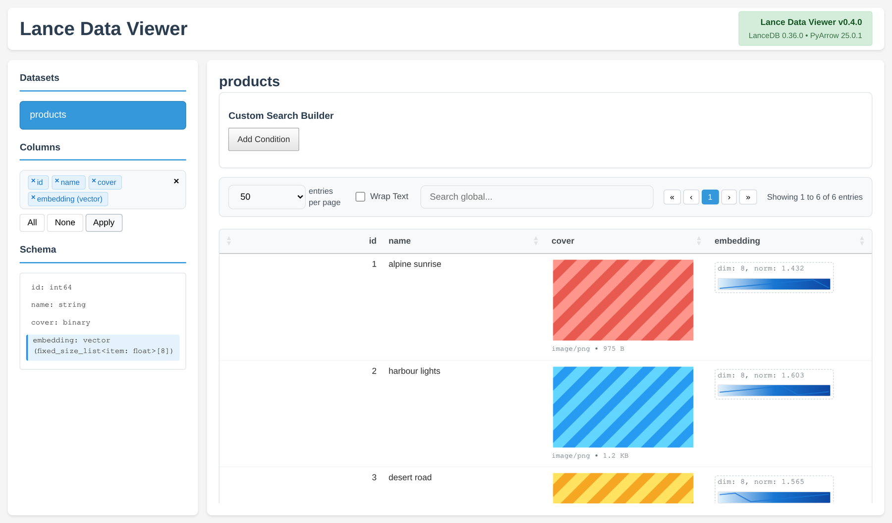

# Lance Data Viewer (TuchSoft fork)

A read-only web UI for [Lance](https://lancedb.github.io/lance/) datasets.
Mount a folder, open a browser, browse your tables. No database to set up.

This is a fork of [lance-format/lance-data-viewer](https://github.com/lance-format/lance-data-viewer)
that adds **server-side filtering and search** on top of the table view, plus an
**inline preview for media stored in blob columns**. It tracks upstream and now
supports the modern LanceDB line (0.24.3 through 0.36.0, PyArrow 21 through 25).



## What this fork adds

- **Server-side search, filtering, ordering and pagination** via
  [DataTables](https://datatables.net/). Filtering runs in DuckDB over the Lance
  dataset, so it stays fast on tables that do not fit in a page. Includes the
  DataTables SearchBuilder for multi-rule queries, and shareable URLs that carry
  the current table reference.
- **Inline media preview.** Binary columns are inspected by file signature and,
  when they hold an image, audio or video, the table renders it inline. Payloads
  up to 64 KiB are sent base64 and drawn straight in the cell; larger ones are
  described by type and size instead of being shipped to the browser.

Everything else comes from upstream: vector sparklines with CLIP detection,
nested schema handling, text wrapping, multi-version support.

## Quick start (Docker)

1. **Pull the recommended image**

```bash
docker pull ghcr.io/tuchsoft/lance-data-viewer:lancedb-0.36.0
```

2. **Make your data readable (required)**

```bash
chmod -R o+rx /path/to/your/lance
```

3. **Run it**

```bash
docker run --rm -p 8080:8080 \
    -v /path/to/your/lance:/data:ro \
    ghcr.io/tuchsoft/lance-data-viewer:lancedb-0.36.0
```

4. **Open** <http://localhost:8080>

The UI shows the Lance version it is running against in the top-right corner.

## Available images

Pick the container that matches the Lance data format you have on disk:

| Container tag     | LanceDB | PyArrow  | Use case                                  |
| ----------------- | ------- | -------- | ----------------------------------------- |
| `lancedb-0.36.0`  | 0.36.0  | 25.x     | **Recommended** for current datasets      |
| `lancedb-0.33.0`  | 0.33.0  | 16 - 25  | Datasets written by the 0.33 line         |
| `lancedb-0.29.2`  | 0.29.2  | 16 - 21  | Datasets written by the 0.29 line         |
| `lancedb-0.24.3`  | 0.24.3  | 16 - 21  | Datasets from the 2025 line               |

`latest` and `stable` point at the 0.36.0 build.

If you get a compatibility error, step down to an older tag. The build also
accepts the legacy targets `0.16.0`, `0.5`, `0.3.4` and `0.3.1`
(`--build-arg LANCEDB_VERSION=...`); those dependency sets are built locally
rather than published, because their packages are no longer on PyPI.

## Features

- **Read-only browsing** with a left sidebar for datasets, columns and schema
- **Server-side search, filtering, ordering and pagination** (DataTables +
  DuckDB)
- **Inline media preview** for images, audio and video held in blob columns
- **Vector visualization** with CLIP detection and sparkline charts
- **Nested schema support**: structs, lists, fixed-size lists and vectors inside
  objects
- **Multi-version support**, one image per Lance line
- **Graceful handling** of corrupted or partially readable datasets

## Supported data types

**Fully supported**

- Scalars: string, int, float, timestamp, boolean, null
- Vectors: `fixed_size_list<float>[N]` and modern `Vector(dim)` fields
- Nested structures: structs, maps, lists, and vectors inside them
- Binary columns: decoded to text when valid UTF-8, previewed inline when they
  match a known image, audio or video signature, otherwise base64

**Limited**

- Legacy `pa.list_(pa.float32(), dim)` vectors: schema is shown, data may warn
- Vectors above 2048 dimensions: preview only

**Not supported**

- Binary (uint8) vector columns and multi-vector columns
- Write operations: this is a read-only viewer

## Configuration

| Variable    | Default | Notes                                                    |
| ----------- | ------- | -------------------------------------------------------- |
| `DATA_PATH` | `/data` | Directory holding the Lance tables                       |
| `PORT`      | `8080`  | Not used by the plain `docker run`; set your own mapping |

Change the published port with `-p 9000:8080`. Keep the `:ro` flag on the mount.

## Build from source

```bash
docker build -f docker/Dockerfile \
    --build-arg LANCEDB_VERSION=0.36.0 \
    -t lance-data-viewer:dev .

docker run --rm -p 8080:8080 -v "$(pwd)/data:/data:ro" lance-data-viewer:dev
```

Run the API directly without Docker:

```bash
cd backend
pip install -c constraints-0.36.0.txt -r requirements.txt
DATA_PATH=/path/to/lance python -m uvicorn app:app --host 0.0.0.0 --port 8080
```

Useful endpoints:

```bash
curl http://localhost:8080/healthz
curl http://localhost:8080/datasets
curl "http://localhost:8080/datasets/my-table/rows?limit=5"
```

## Notes on compatibility

The fork was brought up to the current upstream code and dependency set, so it
runs on LanceDB 0.36 with FastAPI 0.141 and NumPy 2. The pagination path uses
`LanceTable.take_offsets()` where available and falls back to an Arrow slice on
older Lance builds, so a single image still serves the whole range of supported
Lance lines.

## Demo data

`scripts/make-demo-dataset.py` builds a small Lance table with scalars, an
8-dimensional vector column and four blob columns (PNG, JPEG, WAV, MP4) so the
media preview can be tried out locally:

```bash
python scripts/make-demo-dataset.py ./demo-data
docker run --rm -p 8080:8080 -v "$(pwd)/demo-data:/data:ro" \
    lance-data-viewer:dev
```

## Upstream and license

Built on [lance-format/lance-data-viewer](https://github.com/lance-format/lance-data-viewer).
The media-preview and dependency work comes from upstream; the DataTables
server-side layer and the pagination compatibility fix are this fork's.

MIT, same as upstream. See [LICENSE](LICENSE).
